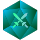
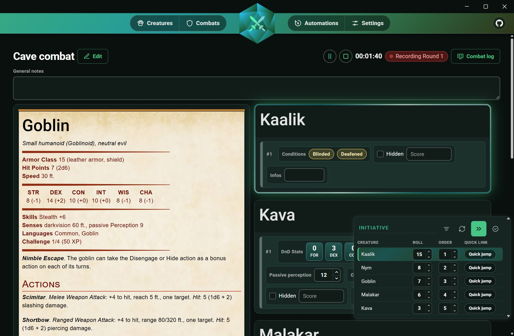
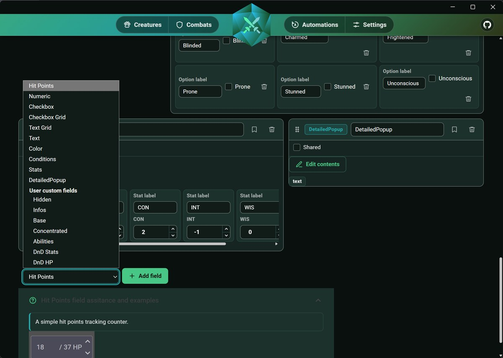
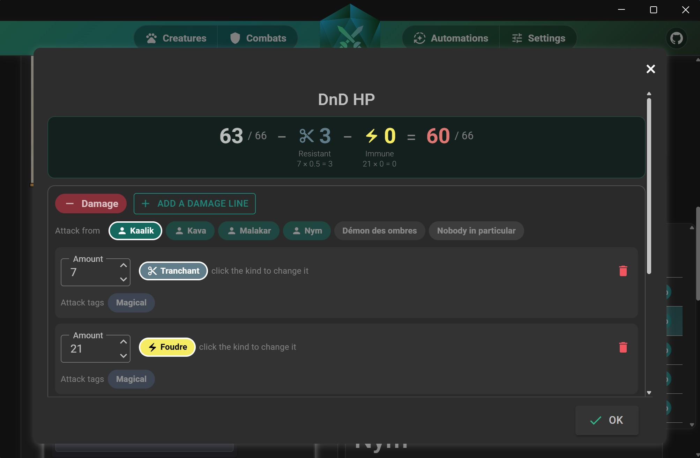
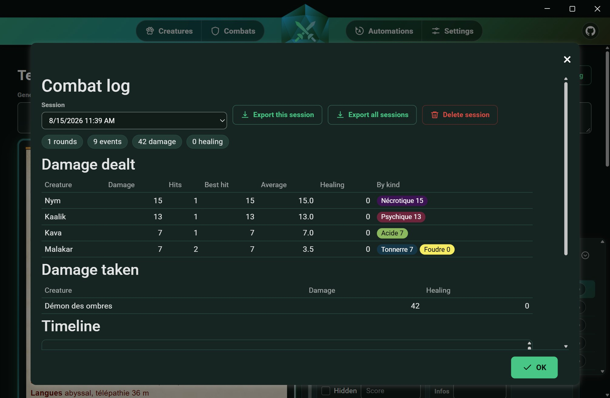
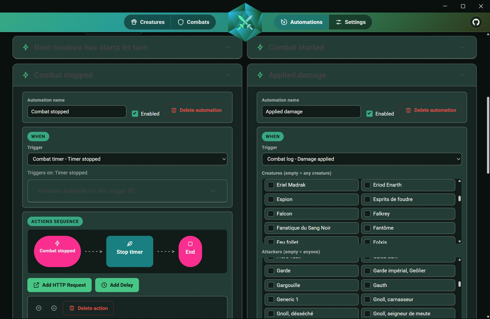
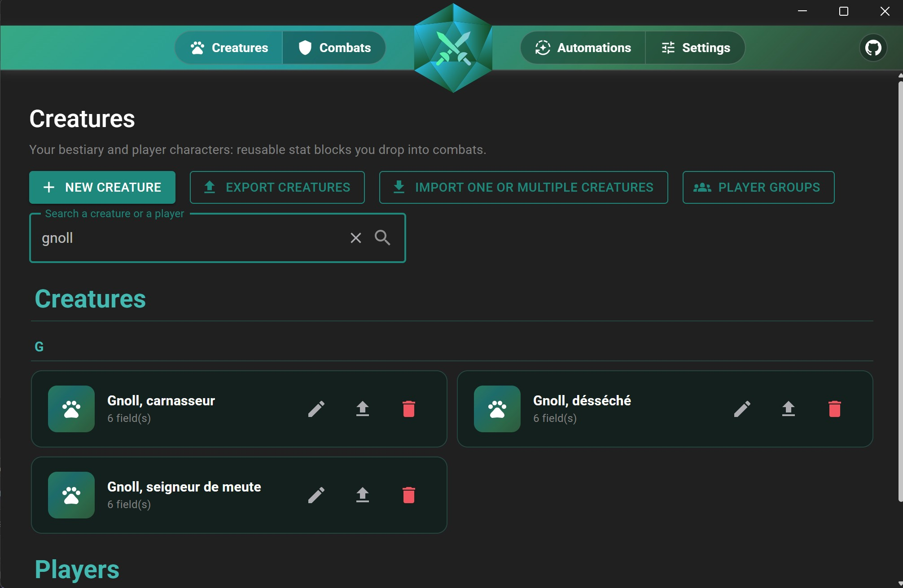
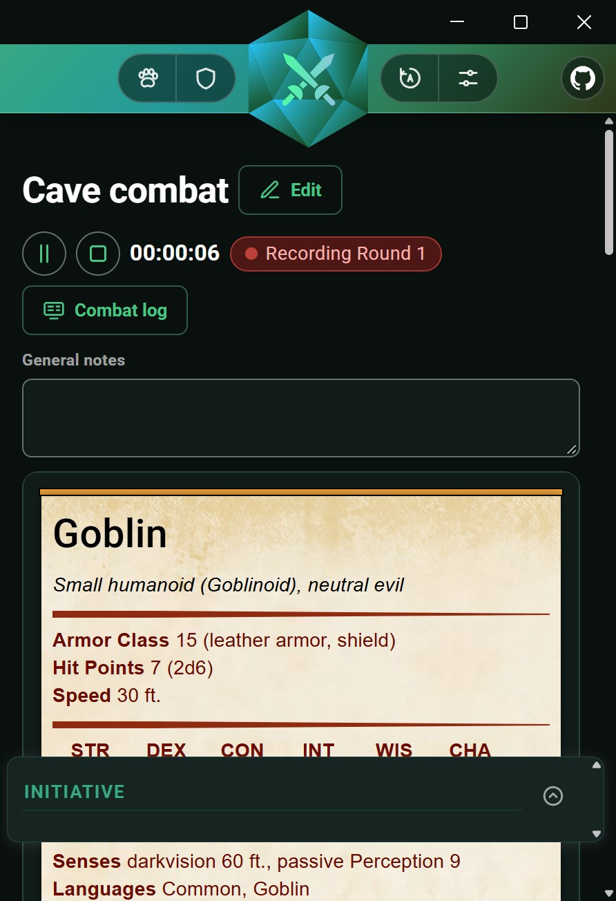

<p align="center">
   
</p>

<h1 align="center">DiceCombats</h1>

<p align="center">
   <a href="https://github.com/YannCharbon/DiceCombats/releases/latest"></a>
   
   
</p>

<p align="center">
   <a href="https://yanncharbon.github.io/DiceCombats/"><b>Website</b></a> &middot;
   <a href="https://github.com/YannCharbon/DiceCombats/releases/latest"><b>Download</b></a> &middot;
   <a href="https://yanncharbon.github.io/DiceAudio/"><b>DiceAudio</b></a>
</p>

DiceCombats helps you manage combat during your tabletop RPG sessions, regardless of the game system you
use. Build your creatures with the fields you need, track initiative and hit points during the fight,
and let the app handle the rest: damage resistances, combat logs and automations with external
applications.



---

## What it does

- **Custom fields.** A creature is built from the fields you choose to add. Ten field types are
  available: hit points, numbers, text, checkboxes, grids, stats, conditions, colours and detailed
  pop-ups. Once a field is configured, you can save it as a custom field and reuse it on any other creature.
- **Bestiary and player groups.** Your creatures and player characters are stored in the same searchable
  list and can be reused in any combat. You can also organise players into groups, so the whole party can
  be added to a combat in one click.
- **Import from aidedd.org.** If you play D&D, you can paste the URL of a monster page from aidedd.org and
  import its stat block directly, whether it uses the 2014 or 2024 format. Spell links open inside the
  app, so you do not need to leave it during combat.
- **Live combat.** During combat, roll initiative, sort the turn order and jump directly to any creature
  in the list. A timer keeps track of the fight, you can keep general notes, and each instance of a
  creature maintains its own values.
- **Damage types and resistances.** Define the damage types used by your system, then set each creature's
  resistances, immunities and vulnerabilities. Attack properties such as magical damage are taken into
  account, along with temporary and negative hit points. When you apply damage, the app calculates the
  actual amount and shows you the full breakdown before you confirm it.
- **Combat log.** Everything that happens during combat is recorded: damage dealt by each creature,
  damage taken, the breakdown by damage type and round-by-round progress. You can review the statistics
  afterwards and export the session as JSON.
- **Automations.** Combat events can be sent to any external application through HTTP requests. Choose
  a trigger, apply filters if needed, and build a sequence of requests with optional delays.
- **Import, export and languages.** Export your creatures and combats to share them with other game
  masters, then import them again when needed. The interface is available in English and French on
  Windows and Android. DiceCombats is free and open source under GPL-3.0.

---

## The custom fields

Custom fields are at the heart of DiceCombats. A creature does not use a fixed sheet: you add the fields
you need and configure them for your game system.



Choose a field type from the list and add it to the creature. Give it a name, configure it, and move it
up or down on the card as needed. To reuse a field, save it as a custom field: it then appears in the
same list and can be added to any other creature. During combat, each field switches to its in-play view,
and every instance of a creature keeps its own values.

| Field type | What you put in it |
|---|---|
| **Hit points** | Current and maximum hit points, together with your system's damage types, the creature's resistances, temporary hit points and, if your game uses them, negative hit points. |
| **Numeric** | A simple number with an optional maximum and unit. Useful for armour class, mana points, ammunition, or anything else you need to track. |
| **Text** | A free-text field, either single-line or multi-line. Useful for notes you want to update during combat. |
| **Checkbox** | A list of checkboxes with labels you define. Useful for legendary actions, spell slots, wounds, or exhaustion levels. |
| **Checkbox grid** | Checkboxes arranged in rows and columns. Useful for spell slots by level or ammunition by weapon. |
| **Text grid** | A small table you can fill in however you like. Useful for attacks with their bonuses and damage, equipment, reactions, or similar structured information. |
| **Stats** | A row of labelled values. Useful for D&D's six ability scores or any set of attributes in your system. |
| **Conditions** | The conditions used by your game, which you can add or remove during combat. They are displayed directly on the creature card. |
| **Colour** | A colour assigned to a specific instance of a creature in combat. For example, match it to the colour of the miniature's base on your table, so you always know which of the four goblins is which. |
| **Detailed pop-up** | A button that opens a window containing text, Markdown, templated HTML, or a PDF. Useful for spells, abilities, or any longer description you do not want permanently displayed on the card. |

Each field type is shown on the
[website](https://yanncharbon.github.io/DiceCombats/#fields), with both its configuration and its in-combat view.

---

## A look at the app

These screenshots are taken from a real campaign, so they show what the app looks like during a session.

### Applying damage

When applying damage, enter each part of the attack, select the creature dealing it, and review the result
before confirming. The calculation breakdown is shown below the final value, so you can always see
exactly how the damage was resolved.



### The combat log

Each combat creates a recorded session. You can review damage dealt by each creature, including its
highest hit and average damage, the breakdown by damage type, damage taken by each target, and a
round-by-round timeline. Sessions can be exported as JSON together with their statistics.



### External automations

DiceCombats can trigger HTTP requests to any external API. For example, you can play a sound or trigger
a lighting effect when a player deals damage, or change the lighting around the table as turns change.
Choose a trigger, filter it by attacker or damage type, and send an HTTP request using values from the
event. More complex sequences can combine several requests with delays between them. The editor lists
all variables available for each trigger.



### The creature list

All your creatures and player characters are kept in one searchable list, grouped by initial. From here
you can import and export creatures and manage your player groups.



### Experimental Android support

The app uses a responsive layout and is available for Android as an APK. Android support is currently
experimental, and some views may still have limitations.

<p align="center">
   
</p>

More screenshots on the [website](https://yanncharbon.github.io/DiceCombats/#screenshots).

---

## Your data

- **Sharing.** A combat is exported with the creatures it uses, so whoever imports it gets the whole
  encounter. In Settings, in the Data section, **Export the whole library…** saves your creatures,
  combats, player groups, user custom fields and automations in one file, without the access tokens of
  your automations. When you import a file and some items are already in your library, you choose for
  each one whether to import it as a copy, replace the local one or keep yours. A backup is made first.
- **Backups.** DiceCombats backs up your data the first time you open it each day, and before every
  import, restore or copy of your data to another folder. The most recent backup is shown in Settings
  with a **Restore** button, and **All backups…** lists the others.
- **Using several computers (Windows).** With **Choose another folder…**, you can keep your data in a
  folder that OneDrive, Dropbox or another service keeps in sync. If the folder already holds
  DiceCombats data, you can use it, replace it with yours or merge both. Please open DiceCombats on one
  computer at a time: it warns you when it is already open elsewhere, and offers to reload your data
  when another computer has changed it. Please also set the folder to always keep its files on this
  device.
- **Android.** The data stays on the device. To take it to another device, export the whole library or
  save a backup to a file, then import or restore it there.

More details on the [website](https://yanncharbon.github.io/DiceCombats/#data).

---

## The Dice ecosystem

The Dice ecosystem currently includes two apps: DiceCombats and DiceAudio.
[**DiceAudio**](https://github.com/YannCharbon/DiceAudio) complements DiceCombats by handling the
audio side of your game table.

DiceAudio provides a library of music, ambience tracks and sound effects, layered scenes that can fade
smoothly from one context to another, and scenarios for an entire session. It exposes a local API,
allowing DiceCombats automations to start a scene or move it to the next step when something happens
during combat.

---

## Installation

There is no installer and no account to create. DiceCombats stores all of its data locally on your device,
in a folder you can choose on Windows.

Get the latest build here: [](https://github.com/YannCharbon/DiceCombats/releases/latest)

- **Windows**: download the ZIP from the latest release, extract it anywhere and run `DiceCombats.exe`.
  You can pin it to the Start menu for easier access.
- **Android**: download and install the APK. The Android build is experimental, and some views may not
  yet display perfectly.

## Build from source

You need the [.NET 10 SDK](https://dotnet.microsoft.com/download) and the MAUI workloads installed.
All other dependencies are restored from NuGet. The solution can also be opened in Visual Studio.

```bash
git clone https://github.com/YannCharbon/DiceCombats.git
cd DiceCombats
dotnet workload install maui-windows maui-android
dotnet publish DiceCombats/DiceCombats.csproj -f net10.0-windows10.0.19041.0 -c Release -p:RuntimeIdentifierOverride=win10-x64 -p:WindowsPackageType=None -p:IncludeAllContentForSelfExtract=true -p:PublishReadyToRun=true -p:IncludeNativeLibrariesForSelfExtract=true
```

The Android package is built the same way with `-f net10.0-android`. The binaries are produced in
`DiceCombats/bin/Release/`.

---

## Contribute

- **Issues and ideas**: if you find a bug or have an idea for a new feature, open an issue on the
  repository. [](https://github.com/YannCharbon/DiceCombats/issues)
- **Pull requests**: contributions are welcome. Please document your changes and follow the style of the
  surrounding code. [](https://github.com/YannCharbon/DiceCombats/pulls)
- **License**: the project is licensed under GPL-3.0-or-later; see [LICENSE](LICENSE). The source code
  is open and will remain open.

## Support the project

DiceCombats is free, and I develop it in my spare time, so updates and fixes may sometimes take a while.
If the app is useful at your table, a donation helps me keep working on it.

[](https://www.paypal.com/donate/?hosted_button_id=4X9ZURL5T4E6N)

---

## AI usage notice

I started developing DiceCombats in July 2024, when I did not yet consider AI coding tools reliable
enough for this kind of work. Until early 2026, I wrote the entire codebase myself. As these tools have
improved rapidly, I have started using Claude Code to help me implement new features faster.

I enjoy writing code, but what I value even more is having time to work on my TTRPG scenarios. Using AI
for part of the development work gives me more time for that creative side of the hobby.

If the use of AI in the project is a concern for you, I completely understand if you would rather not use
DiceCombats. I do, however, want to make one thing clear: AI is a development tool here. The features,
design choices and overall direction of DiceCombats still come from me, as a game master building a tool
for other game masters.

---

Thanks for using DiceCombats. Happy gaming!